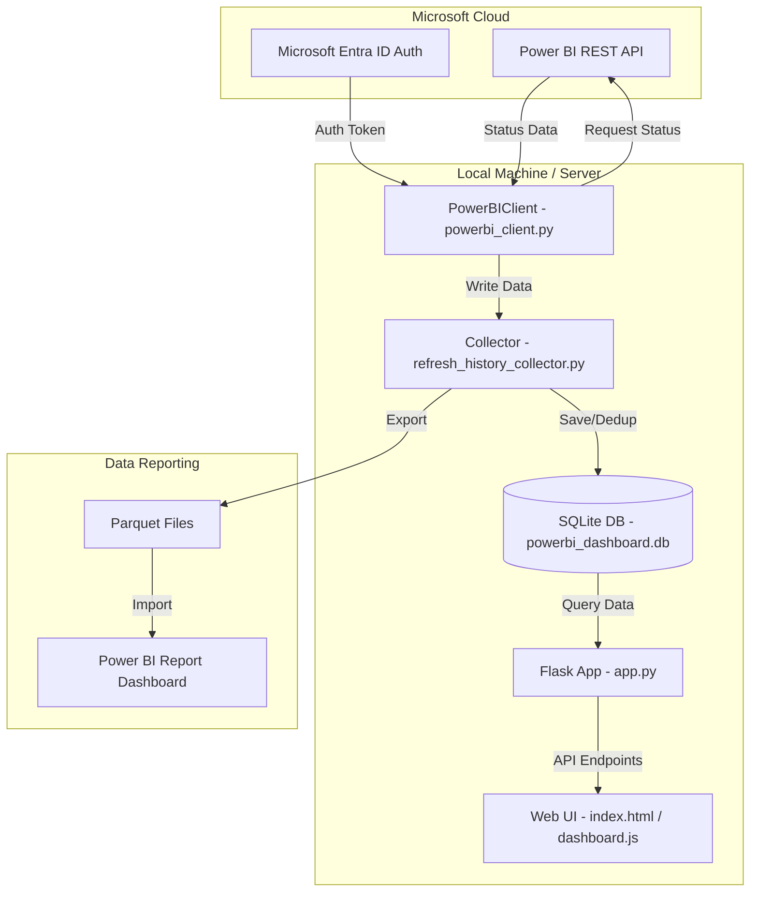
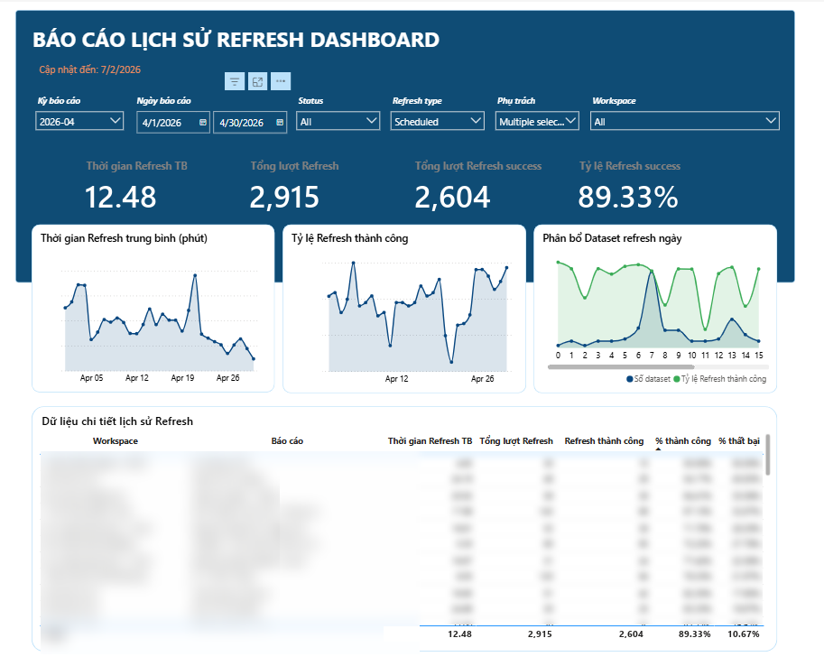
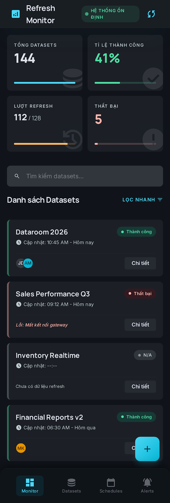

# Power BI Refresh Monitor 📊

[English Version Below | Bản tiếng Việt ở bên dưới]

---

## 🇻🇳 Tiếng Việt

**Power BI Refresh Monitor** là một hệ thống giám sát và quản lý trạng thái tự động làm mới (Data Refresh) cho các báo cáo Power BI quy mô doanh nghiệp. 

Hệ thống được phát triển nhằm giải quyết bài toán quản lý hàng trăm báo cáo (dataset) trên Power BI Service mà không cần phải mở giao diện web Microsoft liên tục, đồng thời tối ưu hóa tài nguyên mạng và lưu trữ lịch sử làm mới không giới hạn.

### 🌟 Tính Năng Nổi Bật

1. **Giám Sát Thời Gian Thực (Realtime Monitoring):** Giao diện Web Dashboard trực quan (hỗ trợ cả giao diện Desktop và Mobile), tự động cập nhật trạng thái của tất cả các datasets đang theo dõi.
2. **Thu Thập & Lưu Trữ Lịch Sử:** Background Collector tự động chạy định kỳ, thu thập lịch sử refresh từ Power BI API và lưu trữ lâu dài vào cơ sở dữ liệu SQLite (vượt qua giới hạn lưu trữ ngắn hạn của Microsoft).
3. **Phân Tích Dữ Liệu Tích Hợp:** Đồng bộ hóa dữ liệu từ SQLite ra định dạng Parquet để nạp trực tiếp vào Power BI Desktop, tạo nên một báo cáo phân tích hiệu năng refresh hoàn chỉnh.
4. **Xác Thực Bảo Mật (MFA):** Sử dụng cơ chế MSAL Device Code Flow để xác thực an toàn với tài khoản Microsoft (kể cả khi bật bảo mật đa lớp MFA), tự động gia hạn token cache lên tới 90 ngày.
5. **Chế Độ Demo:** Cho phép trải nghiệm toàn bộ giao diện dashboard với dữ liệu mô phỏng ngay lập tức mà không cần cấu hình tài khoản Microsoft.

### 📐 Kiến Trúc Hệ Thống (Architecture)



### 🚀 Hướng Dẫn Nhanh (Chạy Demo Mode)

Bạn có thể chạy thử nghiệm giao diện ngay lập tức bằng lệnh sau:

1. **Cài đặt thư viện:**
   ```bash
   pip install -r requirements.txt
   ```
2. **Khởi chạy chế độ Demo:**
   ```bash
   python app.py --demo
   ```
3. **Mở trình duyệt:** Truy cập **[http://localhost:5555](http://localhost:5555)** để xem giao diện Dashboard.

### ⚙️ Cấu Hình Chạy Thực Tế (Real Mode)

Để hệ thống kết nối trực tiếp với tài khoản Power BI của bạn:

1. Đổi tên file `config.example.yaml` thành `pbi_config.yaml`.
2. Khai báo mã **Tenant ID** và **Client ID** ứng dụng của bạn (hoặc giữ nguyên Client ID mặc định của Azure CLI để tự động hỗ trợ MFA).
3. Điền danh sách **Workspace ID** và **Dataset ID** cần theo dõi vào file cấu hình.
4. Chạy script để quét và tự động cập nhật config:
   ```bash
   python sync_config.py
   ```
5. Chạy server chính:
   ```bash
   python app.py
   ```
   *Lưu ý: Trong lần đầu tiên khởi chạy, hãy làm theo hướng dẫn trên màn hình terminal để truy cập [microsoft.com/devicelogin](https://microsoft.com/devicelogin) và nhập mã code xác thực.*

---

## 🇬🇧 English

**Power BI Refresh Monitor** is an enterprise-grade monitoring and management system designed to track data refresh statuses across multiple Power BI workspaces and datasets. 

It provides an intuitive web interface to oversee hundreds of reports in real-time, stores historical logs beyond Microsoft's default limits, and exports clean data to generate dedicated performance reports.

### 🌟 Key Features

1. **Real-time Web Dashboard:** A responsive UI (Desktop & Mobile optimized) displaying key operational metrics: Success Rate, Total Refreshes, Active Failures, and Dataset lists.
2. **Historical Log Collection:** A periodic background collector fetches data from the Power BI API, deduplicates records, and stores them in a local SQLite database for long-term analytics.
3. **Integrated Reporting Pipeline:** Automatically syncs and exports database records into optimized Parquet files, allowing you to feed a Power BI Desktop report with historical logs.
4. **Secure MFA Authentication:** Leverages Microsoft's MSAL Device Code Flow to authorize securely (even with Multi-Factor Authentication enabled) and caches tokens for up to 90 days of headless execution.
5. **Interactive Demo Mode:** Get a taste of the system instantly using mock datasets without logging into any Microsoft account.

### 🚀 Quick Start (Demo Mode)

You can run the web dashboard locally with mock data by following these steps:

1. **Install Dependencies:**
   ```bash
   pip install -r requirements.txt
   ```
2. **Run Demo Mode:**
   ```bash
   python app.py --demo
   ```
3. **Access Dashboard:** Open your browser and go to **[http://localhost:5555](http://localhost:5555)**.

### ⚙️ Production Setup (Real Mode)

To connect the application to your real Power BI workspace:

1. Rename `config.example.yaml` to `pbi_config.yaml`.
2. Configure your Azure **Tenant ID** and **Client ID** (or leave the default Azure CLI Client ID, which easily supports MFA).
3. Add the target **Workspace IDs** and **Dataset IDs** you wish to monitor under the `powerbi` configuration block.
4. Run the configuration sync script to auto-discover and map datasets:
   ```bash
   python sync_config.py
   ```
5. Start the web application:
   ```bash
   python app.py
   ```
   *Note: On your first run, check your terminal for the Microsoft Device Login prompt, visit [microsoft.com/devicelogin](https://microsoft.com/devicelogin), and enter the 9-character code to log in.*

---

## 📸 Screenshots

### Desktop Power BI Analytics Report
*Báo cáo phân tích hiệu năng refresh tích lũy trên Power BI Desktop (đọc dữ liệu từ file Parquet xuất bởi hệ thống).*



### Mobile Web UI
*Giao diện giám sát nhanh trên thiết bị di động.*



---

## 🛠️ Tech Stack & Structure

- **Backend:** Python 3.9+, Flask, SQLite3, YAML
- **Frontend:** HTML5, Vanilla CSS, JS (ES6), Chart.js
- **Auth:** MSAL (Microsoft Authentication Library)
- **Data Export:** Pandas, PyArrow (Parquet Format)

```
powerbi-refresh-monitor/
├── .gitignore
├── LICENSE                      # MIT License
├── README.md                    # Bilingual documentation
├── requirements.txt             # Python dependencies
├── config.example.yaml          # Configuration template
├── app.py                       # Main Flask web application
├── powerbi_client.py            # Microsoft API wrapper (Auth & Fetch)
├── refresh_history_collector.py # Background SQLite database writer & Parquet exporter
├── sync_config.py               # Auto-sync tool for workspaces
├── auto_update_config.py        # Append new datasets automatically
├── scan_only.py                 # CLI tool to list workspaces in YAML
├── screenshots/                 # Application & Report images
│   ├── powerbi_report.png
│   └── mobile.png
├── static/                      # CSS & Javascript static assets
└── templates/                   # Flask HTML templates
```
